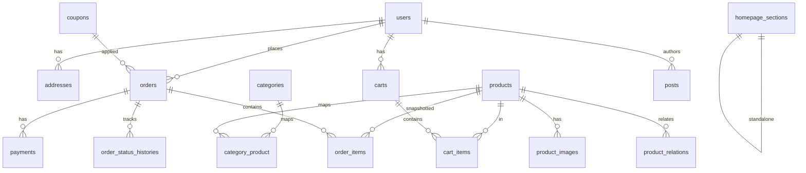

# Database Architecture

**Engine:** InnoDB  
**Charset:** `utf8mb4` / `utf8mb4_unicode_ci`  
**PK strategy:** unsigned big integer, auto-increment  
**Money:** integer **cents** (USD) to avoid float errors — display layer formats  
**Timestamps:** `created_at`, `updated_at` on all durable tables  
**Soft deletes:** users, products, categories, posts, pages, coupons (where recovery/audit matters)  
**Audit:** order status changes via `order_status_histories`; critical admin mutations can log later if needed  

---

## Conventions

| Topic | Standard |
|-------|----------|
| Table names | Plural `snake_case` |
| Column names | `snake_case` |
| Boolean | `is_*` or clear status enums |
| Status fields | string enums backed by PHP Enums |
| Foreign keys | `{singular}_id` + DB FK constraints |
| Unique | slugs per entity; SKU global unique |
| Indexes | FK columns, status, slug, common filter/sort columns |
| Nullable | intentional only (e.g. sale_price_cents, published_at) |

---

## Core Tables (logical design)

> Foundation migrations only create Laravel defaults now. Business tables are implemented module-by-module.

### users

| Column | Type | Notes |
|--------|------|-------|
| id | bigint PK | |
| name | string | |
| email | string unique | |
| email_verified_at | timestamp nullable | |
| password | string | hashed |
| role | string | `customer` \| `admin` |
| phone | string nullable | |
| is_active | boolean | default true |
| remember_token | string nullable | |
| timestamps | | |
| deleted_at | soft delete | |

### addresses

Customer shipping/billing addresses.

| Column | Notes |
|--------|-------|
| user_id FK | |
| type | shipping/billing/both |
| name, line1, line2, city, state, postal_code, country | US-focused |
| is_default | boolean |
| timestamps | |

### categories

| Column | Notes |
|--------|-------|
| parent_id nullable FK | subcategory support without redesign |
| name, slug unique | |
| description nullable | |
| image_path nullable | |
| is_active | |
| sort_order | |
| seo_title, seo_description | |
| timestamps, deleted_at | |

### products

| Column | Notes |
|--------|-------|
| name, slug unique | |
| sku unique | |
| short_description, description | |
| benefits, ingredients, supplement_facts, directions, warnings | text/longText |
| price_cents | int required |
| sale_price_cents | int nullable |
| stock_quantity | int |
| stock_status | in_stock / low_stock / out_of_stock |
| low_stock_threshold | int default e.g. 5 |
| is_featured, is_active | |
| published_at | nullable |
| seo_title, seo_description | |
| timestamps, deleted_at | |

Indexes: `slug`, `sku`, `is_active`, `is_featured`, `stock_status`, `(is_active, published_at)`.

### category_product

pivot: `category_id`, `product_id` unique pair; optional `sort_order`.

### tags / product_tag

Optional merchandising tags.

### product_images

| Column | Notes |
|--------|-------|
| product_id FK | |
| path, alt | |
| sort_order | |
| is_primary | |

### product_relations

| Column | Notes |
|--------|-------|
| product_id | |
| related_product_id | |
| type | related \| cross_sell |
| unique(product_id, related_product_id, type) | |

### coupons

| Column | Notes |
|--------|-------|
| code unique | |
| type | percent \| fixed |
| value | percent int or cents int (document clearly in code) |
| min_subtotal_cents nullable | |
| max_uses nullable, used_count | |
| starts_at, ends_at nullable | |
| is_active | |
| timestamps, deleted_at | |

### carts / cart_items

Guest: session_id; Auth: user_id.  
Items store `product_id`, `quantity` only — **price always recomputed server-side**.

### orders

| Column | Notes |
|--------|-------|
| order_number unique | human-friendly |
| user_id nullable | guest checkout if enabled |
| email, phone | |
| billing_*, shipping_* | denormalized snapshot |
| status | pending/paid/processing/shipped/completed/cancelled/refunded |
| payment_status | pending/paid/failed/refunded |
| fulfillment_status | unfulfilled/partial/fulfilled |
| subtotal_cents, discount_cents, shipping_cents, tax_cents, total_cents | |
| currency | default USD |
| coupon_id nullable, coupon_code snapshot | |
| notes | customer/admin |
| placed_at | |
| timestamps | |

### order_items

Snapshot: product_id nullable, sku, name, unit_price_cents, quantity, line_total_cents.

### order_status_histories

order_id, from_status, to_status, user_id nullable, note, created_at.

### payments

order_id, provider, provider_payment_id, amount_cents, status, raw meta (sanitized), timestamps.  
Webhook idempotency via unique provider event ids table.

### payment_webhook_events

provider, event_id unique, payload hash, processed_at.

### pages

title, slug unique, body, is_published, seo_*, timestamps, deleted_at.

### homepage_sections

| Column | Notes |
|--------|-------|
| key | unique section key (hero, featured_products, …) |
| title, subtitle, body, cta_label, cta_url | |
| image_path nullable | |
| config | JSON for section-specific settings |
| is_enabled | |
| sort_order | |

### posts (blog)

title, slug, excerpt, body, featured_image, author_id, category/tags, is_published, published_at, seo_*, timestamps, deleted_at.

### post_categories / post_tags

As needed for blog taxonomy.

### settings

key unique, value JSON/text — store currency, shipping rules, tax rules, store contact, AI toggles.

### newsletter_subscribers

email unique, subscribed_at, source, is_active.

### chat_sessions / chat_messages (optional persistence)

session_token, user_id nullable, messages role/content, created_at. Keep retention short; no secrets.

### media (optional library)

path, disk, mime, size, alt, folder — if shared media manager needed beyond product images.

---

## Sensitive Data Considerations

- Passwords: hashed only  
- Payment: store provider references + status, never PAN/CVV  
- PII in orders: protect via HTTPS, access policies, minimal logs  
- AI keys: `.env` only  
- Soft-deleted users: retain order history integrity (null or keep FK with soft delete)

---

## Critical Transaction Boundaries

Use DB transactions for:

1. Place order + create items + apply coupon usage  
2. Payment success + inventory decrement + order status  
3. Inventory adjustments that must not oversell (`WHERE stock_quantity >= ?` conditional update)

---

## ERD (logical)

---

## Migration Plan

| Phase | Migrations |
|-------|------------|
| Foundation (now) | Default Laravel users/cache/jobs/sessions |
| Module 02 | users.role, addresses |
| Module 04 | categories, products, images, relations, inventory fields |
| Module 06–07 | pages, homepage_sections, posts |
| Module 09–13 | carts, coupons, orders, payments, webhooks |
| Module 14 | chat tables if persistence required |

Do **not** create full commerce schema until the owning module starts.
